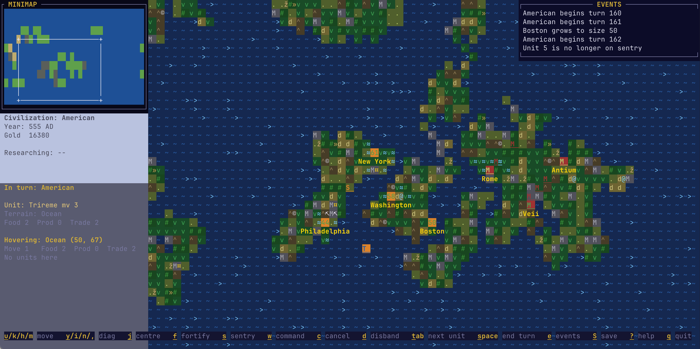

# civterm

A civilization game in your terminal, written in Rust with
[crossterm](https://github.com/crossterm-rs/crossterm) and
[ratatui](https://github.com/ratatui/ratatui).



## Install

You need Rust (installed via [rustup](https://rustup.rs)). The toolchain is
pinned in `rust-toolchain.toml`.

```bash
git clone https://github.com/natritmeyer/civterm.git
cd civterm
make setup        # points git hooks to .githooks (runs make build before commits)
make run          # build and start
```

See [CONTRIBUTING.md](CONTRIBUTING.md) for build details, testing, and project
conventions.

## Starting a game

From the menu (`(N)ew Game`, `(L)oad Saved Game`, `(Q)uit`):

1. Pick a civilization (or random).
2. Pick a competition level (how many rival civilizations).
3. Pick a difficulty (Easy / Normal / Hard).
4. Confirm to start.

A sample save is included as `civterm.civ` in the repo root — load it from the
menu to see a game in progress.

## Camera and movement

Move your selected unit with the keys clustered around `j` (arrow keys also
work). `j` recentres the camera on the selected unit.

|       |            |       |
| ----- | ---------- | ----- |
| `y` ↖ | `u` N      | `i` ↗ |
| `h` W | `j` centre | `k` E |
| `n` ↙ | `m` S      | `,` ↘ |

Drag the mouse to scroll the map. Click to select a unit or tile.

## Unit commands (when a unit is selected)

| Key                                       | Command                      |
| ----------------------------------------- | ---------------------------- |
| `y`/`u`/`i`/`h`/`k`/`n`/`m`/`,` or arrows | Move (diag/orthogonal)       |
| `j`                                       | Centre camera on unit        |
| `f`                                       | Fortify                      |
| `s`                                       | Sentry                       |
| `w`                                       | Open the command picker      |
| `c`                                       | Cancel current order         |
| `v`                                       | Found a city (settlers only) |
| `Tab`                                     | Cycle to next movable unit   |

## City commands

Click a city to open the city window. From there you can:

- **Change production** — pick what the city builds (units/improvements).
- **Buy production** (`b`) — rush-complete the current build for gold.
- **Unfortify / Unsentry / Cancel order** as appropriate.
- Close with `Esc`.

## Game flow

| Key     | Action                                |
| ------- | ------------------------------------- |
| `Space` | End turn                              |
| `Tab`   | Next movable unit                     |
| `e`     | Toggle event log                      |
| `S`     | Save game (prompts for location/name) |
| `L`     | Load game (from menu)                 |
| `?`     | Toggle the command help bar           |
| `q`     | Quit (with confirmation dialog)       |

## Tips

- Cities need food to grow; deficits can cause starvation.
- Trade routes (established by Caravans) bring gold each turn.
- Upkeep costs gold per turn — if you can't pay, your most expensive unit may
  be disbanded.
- Diplomats can enter foreign cities (peace or war) to investigate, steal
  technology, sabotage, incite revolt, or subvert.
- Catapults are siege engines — they bombard cities rather than fighting
  garrison units directly.

## License

MIT — see [LICENSE](LICENSE).
