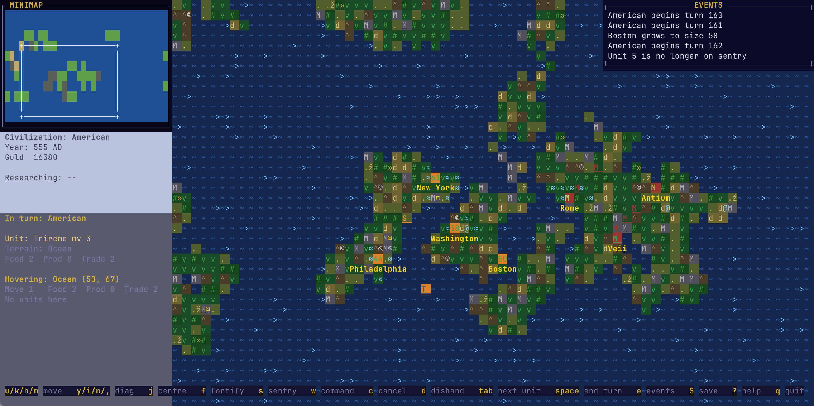

[](https://zed.dev)
[](https://opencode.ai)
[](https://github.com/natritmeyer/civterm/blob/main/LICENSE)
[](https://github.com/natritmeyer/civterm)
[](https://github.com/natritmeyer/civterm)
[](https://github.com/natritmeyer/civterm/commits/main)
[](https://github.com/natritmeyer/civterm/actions)
[](https://github.com/natritmeyer/civterm/actions)

civterm is a terminal Civilization-style game written in Rust. Lead a
civilization from a single settler to a sprawling empire: found and grow
cities, research advances, build units and improvements, explore the
world, and deal with rivals by diplomacy or war.

Built and tested with the [Ghostty](https://ghostty.org) terminal.

## Installation

### macOS

```sh
brew install natritmeyer/civterm/civterm
```

### Linux

Download the `.deb`/`.rpm` for your architecture from the
[releases page](https://github.com/natritmeyer/civterm/releases), then:

```sh
# Debian/Ubuntu (.deb)
sudo apt-get install ./civterm_*_amd64.deb

# Fedora/RHEL (.rpm)
sudo dnf install ./civterm-*.x86_64.rpm
```

Pre-built static (musl) binaries are also provided for minimal/Alpine
systems; download those from the
[releases page](https://github.com/natritmeyer/civterm/releases) too.

### Windows

Download a pre-built binary from the
[releases page](https://github.com/natritmeyer/civterm/releases).

### From source

```sh
git clone https://github.com/natritmeyer/civterm.git
cd civterm
cargo build --release
./target/release/civterm
```
